

  <picture>
    <source media="(prefers-color-scheme: dark)" srcset="axolotl-dark.svg">
    
  </picture>

  <a href="https://www.jaredrojas.com/"><picture><source media="(prefers-color-scheme: dark)" srcset="assets/link-portfolio-dark.svg"></picture></a>
  <a href="https://www.linkedin.com/in/jared-rojas-179991292"><picture><source media="(prefers-color-scheme: dark)" srcset="assets/link-linkedin-dark.svg"></picture></a>
  <a href="mailto:jaredmrojas@gmail.com"><picture><source media="(prefers-color-scheme: dark)" srcset="assets/link-email-dark.svg"></picture></a>

<picture><source media="(prefers-color-scheme: dark)" srcset="assets/header-right-now-dark.svg"></picture>

<a href="https://github.com/cornelldga/Veil-Sur"><picture><source media="(prefers-color-scheme: dark)" srcset="assets/row-building-dark.svg">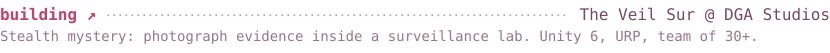</picture></a>

<picture><source media="(prefers-color-scheme: dark)" srcset="assets/row-treasurer-dark.svg">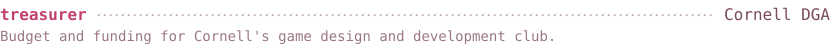</picture>

<picture><source media="(prefers-color-scheme: dark)" srcset="assets/row-looking-for-dark.svg">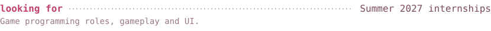</picture>

<picture><source media="(prefers-color-scheme: dark)" srcset="assets/header-projects-dark.svg"></picture>

<a href="https://github.com/jaredrojas08/gravity-gardener"><picture><source media="(prefers-color-scheme: dark)" srcset="assets/row-gravity-gardener-dark.svg">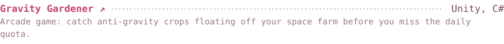</picture></a>

<a href="https://github.com/jaredrojas08/bearplan"><picture><source media="(prefers-color-scheme: dark)" srcset="assets/row-bearplan-dark.svg">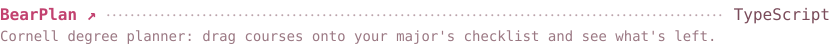</picture></a>

<a href="https://jaredrojas08.github.io/greenplate/"><picture><source media="(prefers-color-scheme: dark)" srcset="assets/row-greenplate-dark.svg">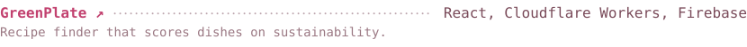</picture></a>

<a href="https://github.com/jaredrojas08/internship-tracker"><picture><source media="(prefers-color-scheme: dark)" srcset="assets/row-internship-tracker-dark.svg">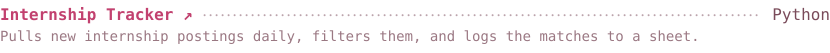</picture></a>

<picture><source media="(prefers-color-scheme: dark)" srcset="assets/header-off-the-clock-dark.svg"></picture>

<picture><source media="(prefers-color-scheme: dark)" srcset="assets/row-likes-dark.svg">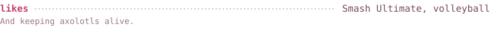</picture>
