Computer Science junior at Cornell with a Game Design minor (May 2028). I want to be a game programmer: I write gameplay systems in Unity and C#, and build web tools when something annoys me enough.

[Portfolio](https://www.jaredrojas.com/) · [LinkedIn](https://www.linkedin.com/in/jared-rojas-179991292) · jaredmrojas@gmail.com

## Right now

- Programmer on [**The Veil Sur**](https://github.com/cornelldga/Veil-Sur), DGA Studios' 2026-27 game: a stealth mystery where you photograph evidence inside a surveillance lab (Unity 6, URP, team of 30+)
- Treasurer of Cornell's Game Design and Development Club (DGA)
- Looking for Summer 2027 game programming internships

Before this: game dev intern at Beastwoe Games on *Nexus Rush*.

## Projects

| Project | What it is | Stack |
| --- | --- | --- |
| [Gravity Gardener](https://github.com/jaredrojas08/gravity-gardener) | Arcade game: catch anti-gravity crops floating off your space farm before you miss the daily quota | Unity, C# |
| [BearPlan](https://github.com/jaredrojas08/bearplan) | Cornell degree planner: drag courses onto your major's checklist and see what's left | TypeScript |
| [GreenPlate](https://jaredrojas08.github.io/greenplate/) | Recipe finder that scores dishes on sustainability | React, Cloudflare Workers, Firebase |
| [Internship Tracker](https://github.com/jaredrojas08/internship-tracker) | Pulls new internship postings daily, filters them, and logs the matches to a sheet | Python |

## Off the clock

Super Smash Bros. Ultimate, volleyball, and keeping axolotls alive.
